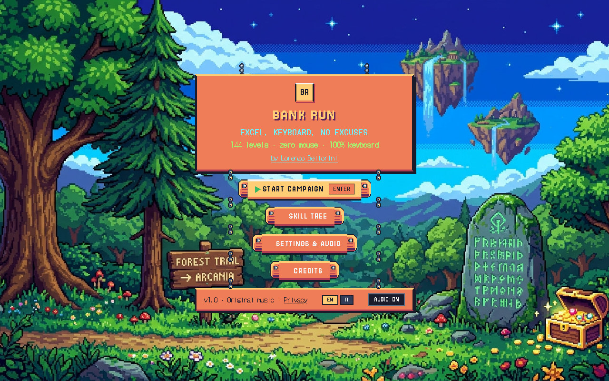
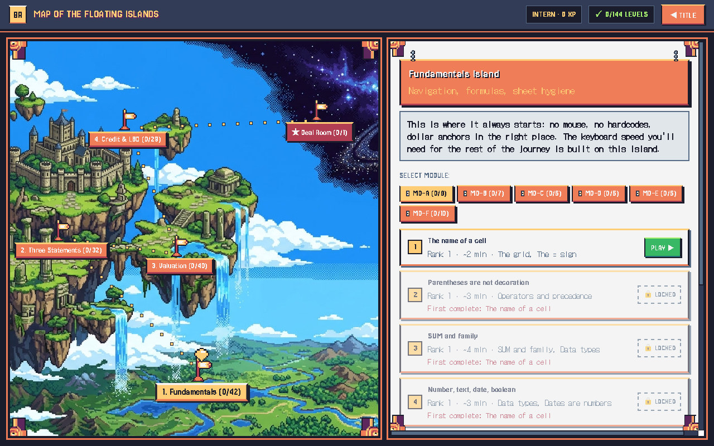
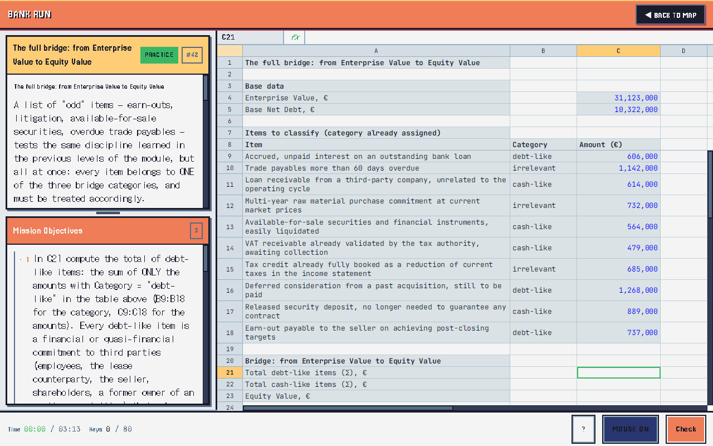

# Bank Run

**An 8-bit game that trains Excel the way investment bankers and private equity analysts use it: keyboard only, real formulas, every answer graded like a model review.**

**Play it:** https://playbankrun.pages.dev (desktop browser with a keyboard; Italian and English)



## What it is

Bank Run is a campaign of **144 levels** spread over five islands, from the first `=` sign to a full leveraged buyout:

1. **Fundamentals**: navigation, formulas, `$` anchoring, sheet hygiene, keyboard speed
2. **Three Statements**: linked income statement, balance sheet and cash flow, normalised EBITDA, working capital
3. **Valuation**: EV to equity bridge, trading comps, precedent transactions, DCF
4. **Credit & LBO**: debt schedules and cash sweep, M&A accretion/dilution, debt capacity, real company accounts
5. **The Deal Room**: a final integrated transaction

Each level is a small spreadsheet with a brief and a list of objectives. When you press **F12** the game checks your work the way a senior analyst would: not just whether the number is right, but whether it comes from a formula instead of a hardcode, whether the anchors are in the right place, and whether the sheet follows formatting conventions. Then it tells you what is wrong.





## Highlights

- **A spreadsheet built from scratch.** Grid, selection, editing and the Excel keyboard model are written in-house: Ctrl+arrows, Shift-extend, F2 edit/point mode, F4 to cycle `$` anchors, Alt key sequences, copy and paste special. Formulas are computed by [HyperFormula](https://hyperformula.handsontable.com/), plus iterative calculation for the circular references that interest calculations create in LBO models.
- **A grader, not an answer key.** Each objective is checked for value (with relative, absolute or hybrid tolerance), structure (formula vs. hardcode, references, anchoring) and style (number formats, input/output colours), with a specific message for each kind of mistake.
- **Procedurally generated levels.** Company numbers are drawn from finance-aware distributions by a seeded random generator: a new seed gives a new, realistic data set (so memorised answers do not carry over), and the same seed always rebuilds the identical level.
- **Game layer.** XP, ranks, par times, a 100+ node skill tree with mastery, keystroke efficiency metrics, and level modes from guided to blind, audit, speedrun (mouse disabled) and boss.
- **Export to Excel.** Any level can be downloaded as a real `.xlsx` with its formulas and formatting.
- **Two languages.** All interface and level content is available in Italian and English, loaded on demand.
- **Original chiptune soundtrack**, synthesised live with the Web Audio API (no audio files).
- **Privacy-first analytics.** Opt-in only, no cookies, no personal data: a small custom client sends anonymous gameplay events to PostHog (EU region), and the KPIs (activation funnel, retention, completion rate and drop-off per level) live in a dashboard. See [docs/ANALYTICS.md](docs/ANALYTICS.md).

## Architecture

```
key press → keySignature → bindings → GridSession → Workbook → HyperFormula
                                           ↓
                                      Grid (React)
```

`GridSession` (`src/game/session.ts`) is the interaction engine and has **no React dependency**: it runs in Node, so every shortcut and editing behaviour is tested without a DOM. React components only render.

| Area | Where |
|---|---|
| A1 addressing, formula tokenizer/parser/AST, reference anchoring | `src/engine/`, `src/engine/formula/` |
| Workbook adapter over HyperFormula, iterative calculation, clipboard, Excel number formats | `src/engine/` |
| Keymap: key signatures, Alt sequences, bindings, cheat sheet | `src/keymap/` |
| Interaction engine | `src/game/session.ts` |
| Grader and feedback messages | `src/grader/` |
| Seeded RNG and finance distributions | `src/rng/` |
| Level templates (144) and skill tree | `src/content/` |
| Input recording, metrics, XP | `src/input/` |
| `.xlsx` export | `src/export/` |
| Grid rendering (virtualised) | `src/grid/` |
| Screens and UI | `src/ui/`, `src/game/PlayScreen.tsx` |
| Translations | `src/locales/{it,en}/` |

## Quality

- **1,200+ automated tests** (Vitest) across the engine, parser, keymap, grader, RNG, export and level templates. Every template is checked to load, to be impossible to pass empty, and to lock and unlock the right cells.
- Strict TypeScript, typechecked on every build.
- About 50,000 lines of TypeScript (most of it level content) and 10,000 lines of tests.

## Tech stack

TypeScript, React 18, Vite, HyperFormula, SheetJS, TanStack Virtual, Vitest. Hosted on Cloudflare Pages. Fonts are self-hosted (no third-party requests).

## Run it locally

```bash
npm install
npm run dev      # http://localhost:5183
npm test
npm run build    # production build in dist/
```

Handy for development: `/?level=M0A-05-ANCORAGGI&seed=42` opens a specific level with a fixed seed, `/?screen=map` opens the map. Deployment notes are in [docs/DEPLOY.md](docs/DEPLOY.md).

## Author

Made by **Lorenzo Bellorini**, [LinkedIn](https://www.linkedin.com/in/lorenzobellorini1404).

## License

[GPL-3.0](LICENSE). The formula engine, HyperFormula, is distributed under GPLv3, so the game is too. Fonts are under the SIL Open Font License; SheetJS is Apache-2.0; React and TanStack Virtual are MIT.
